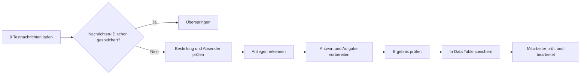

# POOL Total | Kundenservice-Automatisierung

**Kleiner n8n-Prototyp mit fiktiven Daten.** Die Aufgabe: E-Mails zu Bestellung, Versand und Storno prüfen. Der Workflow erstellt Antwortentwürfe und interne Aufgaben. **Er verschickt keine E-Mails und ändert keine Bestellungen.**

## Ablauf

**Technik:** n8n, drei Data Tables, JavaScript-Regeln, JSON und CSV. Kein LLM im laufenden Workflow. Alle Eingaben sind fiktiv.

## Ergebnisse

- **Erster Testlauf:** 9 Eingänge, 8 neue Ergebnisse. E09 wiederholt E01 (gleiche Nachrichten-ID M01).
- **Zweiter Testlauf:** 0 neue Ergebnisse, weiter 8 gespeicherte Einträge.
- **Zusatztest E10:** Keine Bestellnummer; der Workflow fragt nach und gibt keine fremden Bestelldaten aus.
- **Wichtig:** Jeder Entwurf muss von einem Mitarbeiter geprüft werden. Keine automatische Stornierung oder Erstattung.

## Dateien

- [Kurzbericht (max. 2 Seiten)](docs/ZUSAMMENFASSUNG.pdf) und [bearbeitbare Markdown-Fassung](docs/ZUSAMMENFASSUNG.md)
- [Testprotokoll mit Belegen](docs/TESTERGEBNISSE.md)
- [n8n Workflow-Export](workflows/workflow.json)
- [6 Testbestellungen](data/orders.json), [9 Testnachrichten](data/messages.json) und [E10 als Zusatzfall](data/extra_test.json)
- [Originale CSV-Eingaben](data/test_nachrichten_original.csv) und [Bestellungen als CSV](data/test_bestellungen.csv)
- [Ergebnisse des ersten Laufs](results/ergebnisse_original.csv), [E10-Lauf](results/ergebnisse_mit_E10.csv), [Beobachtung zum zweiten Lauf](results/second_run.json)
- [Screenshots](screenshots/)

## Kurze Startanleitung (n8n)

1. **n8n öffnen.** Getestet wurde lokal mit n8n 2.16.1. Eine andere Version kann leicht andere Felder zeigen.
2. Unter **Data tables** drei Tabellen erstellen: `test_bestellungen`, `test_nachrichten`, `verarbeitete_nachrichten`.
3. `test_bestellungen` mit `data/test_bestellungen.csv` füllen. `test_nachrichten` mit `data/test_nachrichten_original.csv` füllen. Beim CSV-Import die technischen Spalten `id`, `createdAt`, `updatedAt` bei Bedarf weglassen. Die eigentlichen Daten-Spalten als **String** anlegen.
4. Die Tabelle `verarbeitete_nachrichten` **leer** erstellen. Folgende Spalten als **String**: `nachrichten_id`, `eingangs_id`, `absender`, `bestellnummer`, `anliegen`, `antwortentwurf`, `interne_aufgabe`, `datenquelle`, `pruefung_noetig`, `naechster_schritt`, `status`.
5. `workflows/workflow.json` in n8n importieren. In den vier Data-Table-Nodes die **eigenen Tabellen neu auswählen**: `Kundenanfragen laden`, `Neue Nachricht prüfen (Actual duplicate Lookup)`, `Bestelldaten suchen`, `Ergebnis speichern`. IDs aus meinem lokalen n8n gelten nicht auf anderen Systemen.
6. `Testlauf starten` verwenden. Vor dem ersten Test muss `verarbeitete_nachrichten` leer sein. Danach sollten **8 Ergebnisse** gespeichert sein. Ein zweiter Lauf darf **keine neuen Ergebnisse** speichern.
7. Für den Zusatztest `data/extra_test.json` als neue Zeile E10 / M10 zu `test_nachrichten` hinzufügen. Danach wird **ein neues Ergebnis** gespeichert, ohne Bestellnummer und ohne fremde Trackingnummer.

**Wichtig:** Vor einem erneuten Test keine alten Ergebniszeilen löschen, wenn die Duplikatprüfung getestet werden soll. Die Tabelle mit echten Arbeitsdaten niemals für eine Demo leeren.

## Grenzen

- **Nicht vorhanden:** echte JTL- oder E-Mail-Verbindung, Versand von E-Mails, echtes Ticketsystem, automatische Stornos und Erstattungen.
- Der Timeout bei E05 ist **simuliert**. Ein echter API- oder Netzwerkausfall hat noch keinen eigenen Alarm- und Wiederanlauf-Prozess.
- Die Identitätsprüfung (Bestellnummer + E-Mail) gilt **nur für die Aufgabe**, nicht für den Echtbetrieb.
- Die Regeln prüfen bekannte Muster. Neue Schreibweisen können eine manuelle Prüfung brauchen.
- Duplikat-Schutz wurde nacheinander getestet, nicht bei gleichzeitig laufenden Prozessen. In Produktion sind zusätzliche Schutzmaßnahmen nötig.
- `pruefung_noetig` erscheint im CSV als **1**. Das bedeutet **true** (Prüfung durch Mitarbeiter nötig).
- Die JSON-Ergebnisdateien wurden aus den **echten n8n-CSV-Exporten** erstellt. `second_run.json` ist eine dokumentierte Beobachtung des zweiten Laufs, kein Roh-Export aus n8n.

## Kurze Live-Demo

Die Videoaufnahme wird als Link ergänzt, sobald die Aufnahme fertig und geprüft ist. Gezeigt werden Ablauf, Normalfall E01 und Problemfall E04.

## Datenschutz

Alle E-Mails und Bestellungen sind aus der Aufgabe und fiktiv. Keine Passwörter oder Zugangsdaten sind enthalten. Keine Produktiv-Anbindung.
